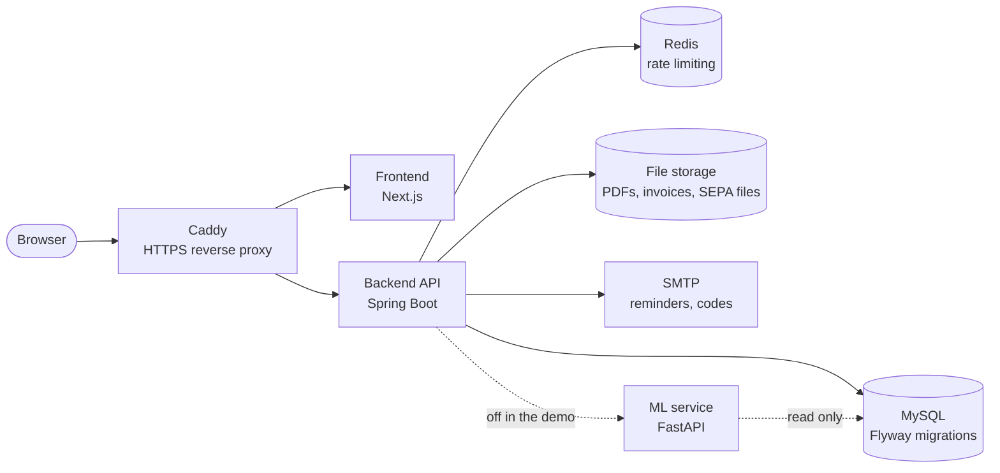
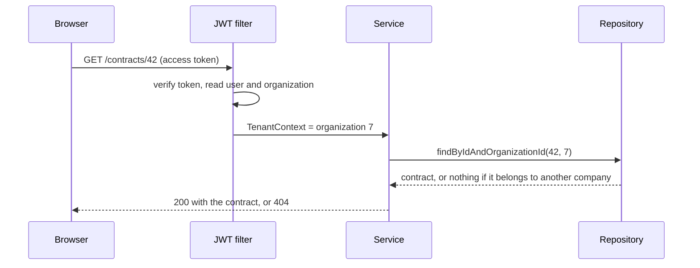
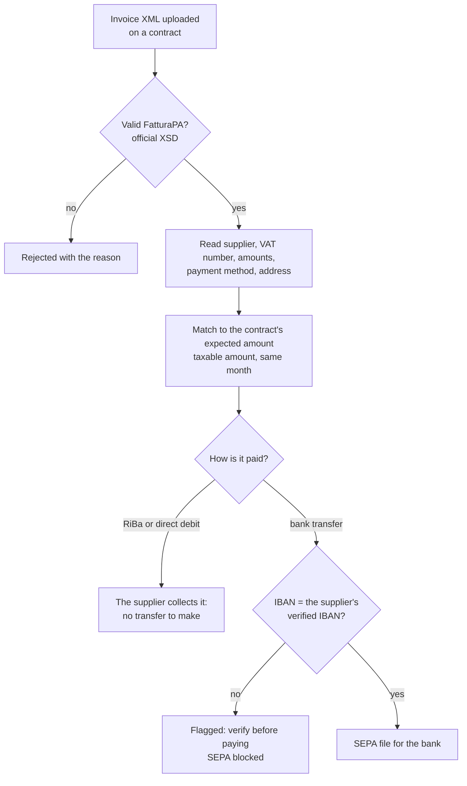

# BCM — Business Contracts Manager

> Never miss the last day to cancel a contract, and know whether your suppliers invoice what was agreed.
> Multi-tenant SaaS for Italian small and medium companies. This repository is the REST API.

[](https://github.com/DonatoCorbacioDev/bcm-v2-backend/actions/workflows/ci.yml)
[](https://openjdk.org/)
[](https://spring.io/projects/spring-boot)
[](#-quality)
[](./LICENSE)

**Live demo:** [bcm.donatocorbacio.dev](https://bcm.donatocorbacio.dev) — log in with `demo` / `BcmDemo#2026`.
The demo company, *Nortiva Solutions S.r.l.*, holds invented data only and is rebuilt every night: click around freely.

**Author:** Donato Corbacio · donatocorbacio92@gmail.com · [LinkedIn](https://www.linkedin.com/in/donato-corbacio/)


---

## 🧭 What it does

Companies lose money on contracts nobody is watching: a contract that renews itself because nobody cancelled it in time, a supplier invoice that doesn't match what was agreed, a payment sent to a bank account a fraudster slipped into an invoice. BCM puts each contract together with what happens around it, and the home page says what to do now.

| | |
|---|---|
| **Tacit renewals** | Notice period and renewal length per contract; BCM computes the last day to give notice and reminds you before it, not on the end date |
| **Supplier invoices** | Italian e-invoices (FatturaPA XML) validated against the official schema, matched to the contract's expected amounts on the taxable amount, credit notes included |
| **Payment fraud checks** | Each supplier has a verified IBAN: an invoice asking to be paid elsewhere is flagged and can't be paid until someone confirms the change |
| **Payments** | SEPA credit-transfer files (pain.001) for invoices paid by bank transfer; RiBa and direct debits are recognised and never paid twice |
| **Counterparties** | Customers and suppliers, with the supplier's address filled in from its own invoices |
| **One company, one space** | Every query is scoped to the organization; tested by one organization trying to read and change another's data |
| **Data rights** | Full export of an organization's data (GDPR art. 20) and deletion with a 30-day grace period |

### What is switched off, and why

The code also holds AI features — semantic document search, an ML risk score, forecasts, reading renewal terms from PDFs — that the demo **doesn't show**. Not because they don't run, but because they aren't reliable enough to show to a customer:

- **Reading renewal and notice terms from contract PDFs** was measured on three blind test sets of Italian clauses written by someone else. On the last one the rules scored precision 0.94 and recall 0.62, below the bar set beforehand (no wrong value, 80% found): two exclusions of the renewal were read as renewals. The feature stays behind a flag; the 72 labelled cases ([`corpus.json`](./src/test/resources/contract-terms/corpus.json), [evaluation](./src/test/java/com/donatodev/bcm_backend/service/ContractTermsExtractorEvaluationTest.java)) are the baseline a model will have to beat.
- **ML risk notifications** are off by default (`ml.risk-notifications.enabled`): the risk model is being redone.

---

## 🏗️ Architecture

### How the pieces fit



One API, one database, one container per service, on a single cloud VM with Docker Compose. A modular monolith on purpose: see [ADR 0001](./docs/adr/0001-modular-monolith.md).

### How a request stays inside its own company



The organization never comes from the request body or URL: it comes from the signed token, and every lookup carries it. An id from another company simply isn't found. See [ADR 0002](./docs/adr/0002-multi-tenancy-strategy.md).

### From a supplier invoice to a payment



### Design decisions

Eight short records of why things are the way they are, in [docs/adr](./docs/adr/README.md): modular monolith, multi-tenancy, refresh-token rotation, a separate ML service, a local LLM, vector search in MySQL, the two-tier test strategy, signed internal claims.

### Stack

Java 21 · Spring Boot 4.1 · Spring Security (JWT, TOTP two-factor) · JPA/Hibernate 7 · MySQL 8 · Flyway (54 migrations) · Redis · Jackson 3 · Apache PDFBox + Tesseract OCR · JUnit 5, Mockito, Testcontainers · SpotBugs + FindSecBugs · SonarCloud

---

## ✅ Quality

| | |
|---|---|
| **Unit and web tests** | 1,800+ (`mvn test`) |
| **Integration tests** | 36 on a real MySQL with Testcontainers, every migration included (`mvn verify`) |
| **Coverage gate** | JaCoCo minimum enforced on every build |
| **Static analysis** | SpotBugs + FindSecBugs at zero findings; every exclusion is written down with its reason in [`spotbugs-exclude.xml`](./spotbugs-exclude.xml) |
| **CI** | Build, tests, SonarCloud and secret scanning on every push |

Numbers change with every commit: the commands are the source of truth. High coverage shows the tests run the code, not that every assertion is meaningful.

**Where to look first:**

- **Tenant isolation** — [`CrossTenantAccessTest`](./src/test/java/com/donatodev/bcm_backend/controller/CrossTenantAccessTest.java) and [`CrossTenantIsolationIT`](./src/test/java/com/donatodev/bcm_backend/integration/CrossTenantIsolationIT.java)
- **What needs attention** — [`HomeAttentionService`](./src/main/java/com/donatodev/bcm_backend/service/HomeAttentionService.java): deadlines, notice periods, invoices to match, changed IBANs
- **Payments** — [`SepaPaymentService`](./src/main/java/com/donatodev/bcm_backend/service/SepaPaymentService.java) and [`PaymentMethods`](./src/main/java/com/donatodev/bcm_backend/entity/PaymentMethods.java)
- **Data rights** — [`OrganizationExportService`](./src/main/java/com/donatodev/bcm_backend/service/OrganizationExportService.java) and [`OrganizationPurgeService`](./src/main/java/com/donatodev/bcm_backend/service/OrganizationPurgeService.java)
- **Migrations** — [`FlywayMigrationIT`](./src/test/java/com/donatodev/bcm_backend/integration/FlywayMigrationIT.java)

---

## ▶️ Run it

The whole stack (database, Redis, backend, frontend) starts with one `docker compose up`: see the [Quick Start in bcm-v2-docker](https://github.com/DonatoCorbacioDev/bcm-v2-docker#-quick-start).

The backend alone, against a local MySQL and Redis:

```bash
cp .env.example .env      # database, JWT secret, mail; see the comments in the file
mvn spring-boot:run       # dev profile; API on http://localhost:8090/api/v1
mvn test                  # unit tests, in-memory H2, no Docker needed
mvn verify                # + integration tests on real MySQL (needs Docker)
```

API documentation: `http://localhost:8090/api/v1/swagger-ui.html` (dev profile).

---

## 🔐 Security and data

- [docs/SECURITY.md](./docs/SECURITY.md) — authentication, tenant isolation, secrets, what's done and what's still open
- [docs/GDPR.md](./docs/GDPR.md) — personal data, export, deletion, retention

In production: HTTPS through Caddy, nightly database backups with a verified off-site copy, uptime monitoring with alerts, metrics endpoint reachable only from the private network.

---

## 🗂️ The four repositories

| Repository | What it is |
|---|---|
| **bcm-v2-backend** (this one) | REST API |
| [bcm-v2-frontend](https://github.com/DonatoCorbacioDev/bcm-v2-frontend) | Web app — Next.js, TypeScript, Tailwind, shadcn/ui |
| [bcm-v2-ml](https://github.com/DonatoCorbacioDev/bcm-v2-ml) | ML service — Python, FastAPI (not used by the demo, being redone) |
| [bcm-v2-docker](https://github.com/DonatoCorbacioDev/bcm-v2-docker) | Docker Compose, production setup, demo reset, backups |

## 🗺️ Roadmap

- **Now (demo 1.0):** usability pass with real users; documentation
- **Next:** reading renewal terms from PDFs with a model that passes the blind test sets; the ML service redone on BCM's real problems
- **Later:** invoices received directly from the Italian exchange system (SdI) instead of uploaded by hand

---

**Donato Corbacio** — full-stack developer (Java, Spring Boot, Next.js, Python), freelance as DonatoLayer, based in Puglia, Italy.
📧 donatocorbacio92@gmail.com · 💼 [LinkedIn](https://www.linkedin.com/in/donato-corbacio/) · 🐱 [GitHub](https://github.com/DonatoCorbacioDev)

The author retains all commercial rights — see [LICENSE](./LICENSE).
