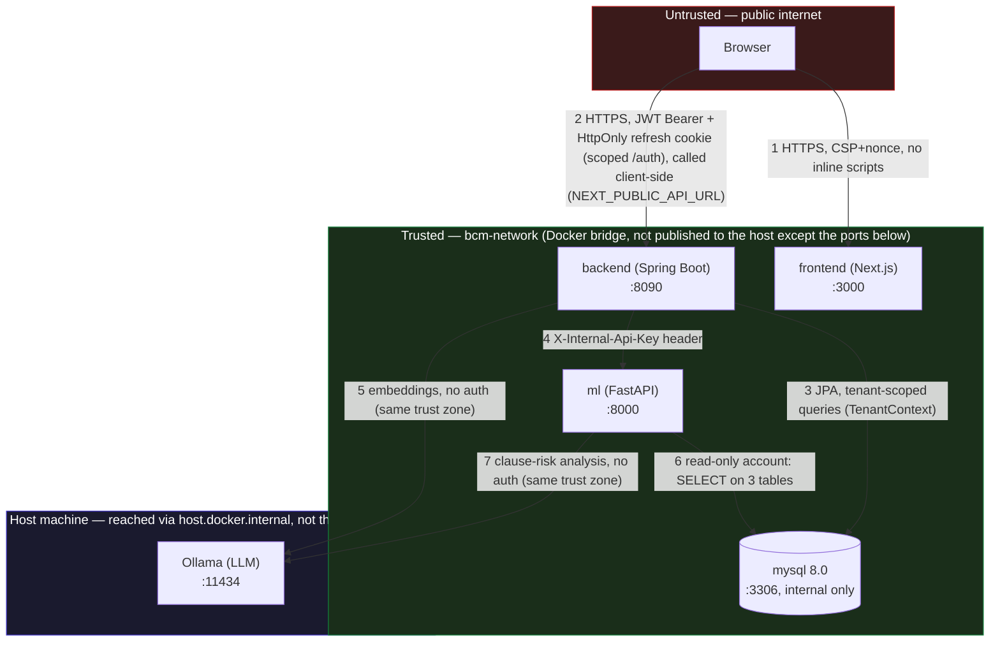

# Security overview

This document summarizes the current threat model and the concrete steps required before
running BCM in production. It reflects the state of the codebase as audited on 2026-11-09
(OWASP API Top 10, API1 object-level authorization),
not aspirational claims — update it whenever a control changes.

For personal-data-specific obligations (GDPR: data categories, sub-processors,
retention, data-subject rights), see `docs/GDPR.md` — this document covers
the technical security controls that back article 32.

## Threat model

### Trust boundaries



**Where the real boundary crossings are, and what's missing:**

1. **Browser → Frontend**: the only crossing with no authentication by design (login page must be reachable). CSP with a per-request nonce is the main control (`middleware.ts`).
2. **Browser → Backend**: every state-changing or data-reading request crosses this boundary directly — the frontend is a single-page app that calls the backend API client-side (`NEXT_PUBLIC_API_URL`), not through a server-side proxy that could otherwise sit in front of it as a second choke point. JWT Bearer token + `HttpOnly`/`Secure`/`SameSite=Lax` refresh cookie scoped to `/auth` are the controls; see the table below for what's not yet covered (distributed rate limiting).
3. **Backend → MySQL**: *not* a zero-trust boundary today — no network-level auth beyond the DB password, and the database has no idea what tenant a query is scoped to. All isolation is enforced in application code (`TenantContext` + explicit `findByOrganization_Id`-style queries), verified against a real database by `CrossTenantIsolationIT` and `BolaJwtMySQLIT` (signed JWTs, committed rows; see `docs/BOLA_TEST_MATRIX.md`). If that discipline ever lapses on a single query, MySQL itself won't stop it — this is the single most consequential trust assumption in the whole system.
4. **Backend → ML**: the one internal hop that *does* carry its own credential (`X-Internal-Api-Key`), because the ML service is a separate deployable with its own attack surface, not just an internal library call.
5–7. **ML/Backend → Ollama, ML → MySQL**: Ollama has no auth at all, because it never leaves the same trust zone (Docker network / host loopback). The ML service reaches MySQL through its own account (`bcm_ml_ro`, created by `bcm-v2-docker/ops/mysql/create-ml-readonly-user.sh`) with `SELECT` on `contracts`, `counterparties` and `financial_values` only: it cannot write anything, nor read users, password hashes or 2FA secrets (in production since 2026-11-09). Acceptable *only* as long as that network boundary holds — the moment any of `mysql`, `ml`, or Ollama's port is published to the host or a public interface, this whole zone's "same trust zone, no auth needed" assumption breaks. `docker-compose.yml` already binds all host-published ports to `127.0.0.1` for exactly this reason; the production checklist below has the equivalent items for a real deployment.

### Asset / threat matrix

| Asset | Threat | Current mitigation | Residual risk |
|---|---|---|---|
| Tenant data (contracts, documents, invoices) | Cross-tenant data leak | `TenantContext` (populated from the JWT `orgId` claim by `JwtAuthenticationFilter`) scopes every repository query in services. Fails closed (2026-11-09): a token without `orgId` authenticates nobody, and a service reached without an organization throws `MissingTenantException` (403) via `TenantContext.require()` instead of querying across organizations. Scheduled jobs (`MonthlyReporter`, `RiskScoreRefresher`) never rely on an empty context: they iterate the organizations and pass each id explicitly. Covered by `CrossTenantAccessTest`, `BolaAuthorizationMatrixTest` and `BolaJwtMySQLIT` | MySQL itself does not enforce tenancy (see trust boundary 3): a new query written without the organization filter would be stopped only by review and the BOLA matrices, not by the database |
| Single objects inside a tenant | A plain manager reading or changing a colleague's contract; a child resource (document, invoice, history entry) addressed through another contract; a client-supplied ID in a request body | `ContractAccessGuard` checks tenant scope, then assignment, on every contract-scoped endpoint; child resources are looked up by both their own ID and the parent contract's; IDs in request bodies (contract, type, area, manager, collaborators) are resolved only inside the caller's organization; create endpoints discard the client-supplied `id`, so `save` can never merge an existing row. Expected results (404 for missing or foreign, 403 for a colleague's contract) are listed in `docs/BOLA_TEST_MATRIX.md` and enforced by `BolaAuthorizationMatrixTest` (H2) and `BolaJwtMySQLIT` (real MySQL) | Workflow approvers may read a colleague's workflow in the same organization, by design |
| Account creation | Anyone creating an account inside an existing organization (e.g. an ADMIN of someone else's company) | The legacy public `POST /auth/register` and `/auth/verify` were removed on 2026-11-09: they accepted `managerId`/`roleId` from the body. Accounts are now created only by `POST /organizations/register` (always a brand-new organization, its first admin confirmed by an emailed code) or by an admin's invitation inside their own organization | None known |
| Public demo account | A visitor using the shared demo login to lock others out or to abuse payment flows | The account named by `BCM_DEMO_LOCKED_USERNAME` cannot change its password, enable 2FA, create SEPA payments, edit payment details or edit financial values (`@DisabledInPublicDemo` + `PublicDemoGuard`); it is a plain manager, not an admin; the demo organization is reset every night | What a visitor types into the demo stays visible to the next visitor until the nightly reset |
| User credentials | Credential stuffing / brute force, weak passwords, a stolen password that keeps working | BCrypt hashing; login rate limiting (`RateLimitingFilter`, Redis-backed and shared across instances), also on `/auth/2fa/verify`; one lockout (`LoginLockout`, 5 failures in 15 minutes) shared by password and 2FA code; a TOTP code is accepted only once (`users.totp_last_used_step`, V57); passwords of 8 characters to 72 UTF-8 bytes, BCrypt's real limit (`@ValidPassword`, checked again before every hash); a password reset, a password change or a 2FA change ends every other session (`SessionRevocationService`: refresh tokens revoked, access tokens issued earlier refused via `users.credentials_changed_at`, V58) | Two-factor authentication is optional, also for ADMIN (accepted, see Known limitations) |
| Reset and invitation links | A database dump or a stolen backup giving working links | Stored only as their SHA-256 (`TokenHash`, V59 hashed the ones already sent), single use, expiring | None known |
| Access/refresh tokens | Token theft / replay | Access token valid 15 minutes (`JWT_EXPIRATION_MS`, 900000 in production since 2026-11-10), `HttpOnly`+`Secure`+`SameSite=Lax` refresh cookie scoped to `/auth`, refresh token rotation with reuse detection, refresh tokens stored as SHA-256 | A stolen access token works until it expires, at most 15 minutes, unless the password or 2FA changes first |
| API surface | Information disclosure via API docs | Swagger UI / OpenAPI JSON disabled in the `prod` profile (`springdoc.api-docs.enabled=false`, `springdoc.swagger-ui.enabled=false`) | None known |
| ML proxy (`MlProxyService` → FastAPI) | Unauthenticated access to the ML service | Shared `X-Internal-Api-Key` header, enforced by the backend on every proxied call. With `ENVIRONMENT=production` (set in `docker-compose.prod.yml`) the ML service refuses to start without `INTERNAL_API_KEY` | Outside production an empty `INTERNAL_API_KEY` disables the check (local dev convenience) |
| ML proxy scope binding (`org_id`/`manager_id`) | A caller in possession of `X-Internal-Api-Key` requesting another org's/manager's data by changing a query param | Backend signs an `X-Internal-Claims` JWT (RS256) asserting `org_id`/`manager_id` per request (`MlClaimsSigner`); FastAPI verifies it with a public key it never holds the private half of (see ADR-0008). Compromising the ML container's environment does not grant the ability to forge a different scope. | Fails closed (2026-11-09): claims without an organization are refused (401) and every ML query is scoped to the organization, a manager only narrowing it. In production the service refuses to start without `INTERNAL_CLAIMS_PUBLIC_KEY`; only outside production does an empty key fall back to the raw query params |
| Subscription tier (`/internal/organizations/{id}/tier`) | Anyone granting themselves a paid plan, or downgrading another org | Not a tenant endpoint — no JWT, explicit `orgId`, never reads `TenantContext`. Two layers (2026-10-20): Caddy answers `403` to every client on `/api/v1/internal*`, so it is only reachable on the VM via `127.0.0.1:8090`; the backend additionally requires `X-Internal-Admin-Key`, compared in constant time (`InternalApiKeyGuard`). Every change is audit-logged (`TIER_CHANGED`, `system:<source>`). | An empty `INTERNAL_ADMIN_API_KEY` disables the endpoint (`404`), so the failure mode of a missing secret is "unavailable", not "open". Anyone with shell on the VM already owns the database anyway, so the key mainly protects against SSRF-style requests from inside the host. |
| Billing webhook (`POST /billing/webhook`) | Forged "payment completed" event granting PRO for free | Public by necessity (Stripe calls it, no JWT). Every event's `Stripe-Signature` HMAC is verified with `STRIPE_WEBHOOK_SECRET` (`Webhook.constructEvent`, which also rejects stale timestamps) before any field is read; a wrong secret or a payload altered after signing is rejected with `400` — both covered in `BillingServiceTest`. Starting a checkout is `ADMIN`-only and scoped to the caller's own org via `TenantContext`; the org id travels to Stripe and back inside the signed event, never from a client-supplied parameter. | Card data never touches BCM (Stripe-hosted Checkout). No Customer Portal yet, so a cancellation has to happen from the Stripe Dashboard; `customer.subscription.deleted` then downgrades to FREE. Out-of-order delivery (a `deleted` arriving before its `completed`) is not handled — acceptable at current volume. |
| Uploaded documents | Malicious file upload / path traversal | 10MB max size, magic-byte PDF validation (not just `Content-Type`), storage path built from UUID + orgId/contractId (original filename never used in the path) | None known |
| Database | Default/weak credentials | Migrations do not embed real production secrets; `V4__create_admin_user.sql` seeds a default admin account, neutralized by `V14__neutralize_default_admin.sql` | The default admin's BCrypt hash is visible in migration history; rotate/disable it explicitly on every new deployment (see checklist) |
| Frontend (bcm-v2-frontend) | XSS / clickjacking / data exfiltration via injected scripts | Content-Security-Policy with a per-request nonce issued in `middleware.ts` (`script-src 'self' 'nonce-…' 'strict-dynamic'`, no `unsafe-inline`), plus `X-Frame-Options: DENY`, `X-Content-Type-Options: nosniff`, `Referrer-Policy: strict-origin-when-cross-origin`, `Permissions-Policy` | `style-src` still allows `'unsafe-inline'` (Radix UI injects inline styles for positioning) — lower severity than script injection but not zero |

## Production security checklist

Before exposing this backend outside a trusted/internal network:

- [x] Generate a fresh `JWT_SECRET` (≥256 bits, Base64) per environment — never reuse the dev/example value. Production: set, 64 characters (secrets check, 2026-11-09).
- [x] Confirm `application-prod.properties` is active (`spring.profiles.active=prod`) so Swagger/API docs stay disabled. Production: `prod` (secrets check, 2026-11-09).
- [x] Set `ML_INTERNAL_API_KEY` (backend) / `INTERNAL_API_KEY` (bcm-v2-ml) to a strong random value — an empty value disables that check entirely. Production: both set (42 characters), `INTERNAL_CLAIMS_PUBLIC_KEY` set in the ML container, `ML_CLAIMS_PRIVATE_KEY` in the backend only; the ML service runs with `ENVIRONMENT=production` (2026-11-09).
- [x] Set `INTERNAL_ADMIN_API_KEY` (`openssl rand -hex 32`) only if manual tier changes are needed, and confirm `curl https://<public-host>/api/v1/internal/organizations/1/tier -X PUT` returns `403` from outside — that is Caddy's layer, independent of the key. Production: `403` from outside (2026-11-09).
- [x] Rotate or disable the default admin account seeded by `V4__create_admin_user.sql` (already neutralized by `V14`, but confirm before going live with a fresh database) — the second command of the check below. Production: `0` enabled `admin` accounts on the V4 hash (2026-11-09).
- [x] Run the production secrets check below on the VM after every change to the environment (last run 2026-11-09: all as expected; `STRIPE_WEBHOOK_SECRET` empty with checkout disabled, to set before enabling payments). It prints only `SET`/`MISSING` and a length, never a value, so its output is safe to paste:

  ```bash
  docker exec bcm-backend sh -c 'for v in SPRING_PROFILES_ACTIVE JWT_SECRET ML_INTERNAL_API_KEY ML_CLAIMS_PRIVATE_KEY STRIPE_WEBHOOK_SECRET FRONTEND_BASE_URL BCM_DEMO_LOCKED_USERNAME; do n=$(printenv "$v" | tr -d "\n" | wc -c); if [ "$n" -gt 0 ]; then echo "$v SET ($n chars)"; else echo "$v MISSING"; fi; done; [ "$(printenv SPRING_PROFILES_ACTIVE)" = prod ] && echo "profile is prod" || echo "PROFILE IS NOT prod"'
  docker exec bcm-mysql sh -c 'mysql -uroot -p"$MYSQL_ROOT_PASSWORD" bcm -N -e "SELECT COUNT(*) FROM users WHERE username = '\''admin'\'' AND verified = TRUE AND password_hash LIKE '\''\$2a\$12\$siyVMp6Lw5gcRw9fAh5GHO%'\''" 2>/dev/null'
  ```

  Expected: every variable `SET` (`JWT_SECRET` at least 44 characters, i.e. 256 bits in Base64; `STRIPE_WEBHOOK_SECRET` may be `MISSING` only while `BILLING_CHECKOUT_ENABLED` is off), `profile is prod`, and `0` from the second command (no enabled `admin` account still on the V4 hash).
- [x] Confirm `FRONTEND_BASE_URL` is set to the real production origin — `CorsConfig` only restricts to it under the `prod` profile. Production: set, the length of `https://bcm.donatocorbacio.dev` (2026-11-09).
- [x] Give the ML service a read-only database account — `bcm-v2-docker/ops/mysql/create-ml-readonly-user.sh` (SELECT on three tables), in production since 2026-11-09.
- [x] Prove tenant isolation from the outside — `bcm-v2-docker/ops/smoke/bola_two_orgs.py` registers two organizations and two managers and tries every cross-organization and cross-manager access over HTTP (46 checks); it runs in the docker repository's CI on every push. Dev profile only, never against production.
- [x] Distributed rate limiter in front of `/auth/**` — `RateLimitingFilter` is now Redis-backed (`RedisRateLimitBucketSource`, via `bucket4j-redis`/Lettuce) in every profile except `test`, so the limit is shared across backend instances instead of resetting per instance. Fails open on a Redis blip *after* successful startup (same "degrade the feature, not the request" posture as the ML proxy — see ADR-0004/0005); Redis is a hard prerequisite to start the app in dev/prod, same as the MySQL datasource. Proven against a real Redis via Testcontainers in `RateLimitingRedisIT` (two independent bucket sources sharing one Redis, not just a mocked proxy manager).
- [x] Enable HTTPS only (terminate TLS in front of the app; cookies are marked `Secure`, so they will silently stop being sent over plain HTTP) — Caddy terminates TLS with automatic certificates and sends a single HSTS header (2026-11-06).
- [x] Set up automated database backups and verify restore procedure — encrypted nightly backups plus a verified offsite copy (`bcm-v2-docker/ops/backup/backup.sh`, `offsite.sh`), restore exercised with `restore-test.sh`; a fresh backup is taken before every deploy.
- [x] Configure alerting on `actuator/health` — UptimeRobot monitors backend and frontend, alert tested live 2026-10-08. Log aggregation is still to do; logs are structured JSON/ECS on the `prod` profile (see `logback-spring.xml`), and `metrics`/`info`/`prometheus` are the only other exposed actuator endpoints.
- [x] `actuator/prometheus` doesn't leak secrets, but it does expose internal request patterns and endpoint names (`bcm.ml.call` tags include which ML endpoints are called and how often). Restricted 2026-10-15 to loopback + private IP ranges at the reverse-proxy layer (`bcm-v2-docker/Caddyfile`, `handle /api/v1/actuator/prometheus` block) rather than Spring Security, since a scraper has no JWT to present — verified from outside returning `403`, `actuator/health` unaffected (`200`). Revisit the trusted-IP list once a real metrics scraper (e.g. Grafana Cloud) is wired, to add its egress range.
- [x] Secret scanning: gitleaks runs in CI (`.github/workflows/ci.yml`), and the full history of all four repositories (883 commits) was scanned on 2026-11-09 with no real secret found (two test-only false positives). Document the rotation procedure if a secret is ever flagged: revoke immediately, issue a new one, redeploy, and confirm the old value no longer authenticates.
- [x] Run `mvn spotbugs:check` and review the FindSecBugs report as part of the release process — clean as of 2026-11-09 (0 findings; first cleaned on 2026-07-16: fixed path traversal containment in `LocalStorageService`, CRLF log sanitization in five schedulers/aspects, narrowed an overly-broad reflection catch in `AuditAspect`; remaining findings in `spotbugs-exclude.xml` are documented false positives, re-verify on every dependency/SpotBugs upgrade since analyzer behavior can shift).
- [x] Automated dependency scanning — Dependabot enabled 2026-07-22 for Maven + GitHub Actions here and for npm + GitHub Actions in `bcm-v2-frontend` (both repos' `.github/dependabot.yml`), weekly PRs plus immediate PRs for security advisories. CycloneDX SBOM generated on every build here and uploaded as a CI artifact, so a point-in-time dependency-version audit doesn't depend on someone remembering to run `npm audit`/`mvn dependency:tree` manually — that manual gap is exactly how the 2026-07-22 Next.js CVEs (DoS, SSRF, cache poisoning) sat unpatched until an explicit review caught them.
- [x] Frontend security headers (CSP, X-Frame-Options, X-Content-Type-Options, Referrer-Policy, Permissions-Policy) — implemented 2026-07-16 via `middleware.ts`. Verified against a real build: a naive static CSP without a nonce broke React hydration entirely, so this needs re-testing (not just re-deploying) if the CSP is ever touched again.

## Known limitations (won't fix without explicit need)

- **Two-factor authentication is optional, also for ADMIN** (accepted risk, 2026-11-11). OWASP API2 suggests requiring it for privileged accounts. It is offered to every user (TOTP, with recovery codes) but not enforced: enforcing it needs a forced-setup step at login and would break the nightly demo reset, which signs in as the demo organization's admin with a password only. What limits the risk meanwhile: lockout and rate limiting on login, the password policy, sessions ended on every credential change, 15-minute access tokens. Revisit before the first paying customer with more than one admin.
- **The `verification_token` table is no longer written** since the public sign-up was removed. It stays, with its entity and repository, because organization purge and the test cleaner still delete its rows; dropping it needs a migration of its own.
- **Deliberate null-organization paths** remain only where no tenant request exists: invitation acceptance (`UserService.completeInvite`, unauthenticated by nature, resolved through the invite token), notifications created by background jobs (`NotificationService.createForUser`) and the ML refresh jobs (`MlProxyService` `fetch*Raw`). None of them is reachable from a tenant HTTP request without an organization.
