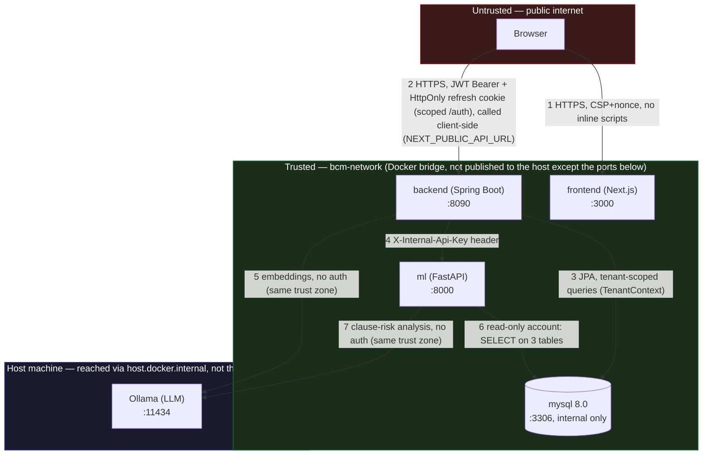

# Security overview

This document summarizes the current threat model and the concrete steps required before
running BCM in production. It reflects the state of the codebase as audited on 2026-11-09
(OWASP API Top 10, API1 object-level authorization),
not aspirational claims — update it whenever a control changes.

For personal-data-specific obligations (GDPR: data categories, sub-processors,
retention, data-subject rights), see `docs/GDPR.md` — this document covers
the technical security controls that back article 32.

## Threat model

### Trust boundaries



**Where the real boundary crossings are, and what's missing:**

1. **Browser → Frontend**: the only crossing with no authentication by design (login page must be reachable). CSP with a per-request nonce is the main control (`middleware.ts`).
2. **Browser → Backend**: every state-changing or data-reading request crosses this boundary directly — the frontend is a single-page app that calls the backend API client-side (`NEXT_PUBLIC_API_URL`), not through a server-side proxy that could otherwise sit in front of it as a second choke point. JWT Bearer token + `HttpOnly`/`Secure`/`SameSite=Strict` refresh cookie (a foreign `Origin` refused with 403 by CORS) scoped to `/auth` are the controls; see the table below for what's not yet covered (distributed rate limiting).
3. **Backend → MySQL**: *not* a zero-trust boundary today — no network-level auth beyond the DB password, and the database has no idea what tenant a query is scoped to. All isolation is enforced in application code (`TenantContext` + explicit `findByOrganization_Id`-style queries), verified against a real database by `CrossTenantIsolationIT` and `BolaJwtMySQLIT` (signed JWTs, committed rows; see `docs/BOLA_TEST_MATRIX.md`). If that discipline ever lapses on a single query, MySQL itself won't stop it — this is the single most consequential trust assumption in the whole system.
4. **Backend → ML**: the one internal hop that *does* carry its own credential (`X-Internal-Api-Key`), because the ML service is a separate deployable with its own attack surface, not just an internal library call.
5–7. **ML/Backend → Ollama, ML → MySQL**: Ollama has no auth at all, because it never leaves the same trust zone (Docker network / host loopback). The ML service reaches MySQL through its own account (`bcm_ml_ro`, created by `bcm-v2-docker/ops/mysql/create-ml-readonly-user.sh`) with `SELECT` on `contracts`, `counterparties` and `financial_values` only: it cannot write anything, nor read users, password hashes or 2FA secrets (in production since 2026-11-09). Acceptable *only* as long as that network boundary holds — the moment any of `mysql`, `ml`, or Ollama's port is published to the host or a public interface, this whole zone's "same trust zone, no auth needed" assumption breaks. `docker-compose.yml` already binds all host-published ports to `127.0.0.1` for exactly this reason; the production checklist below has the equivalent items for a real deployment.

### Asset / threat matrix

| Asset | Threat | Current mitigation | Residual risk |
|---|---|---|---|
| Tenant data (contracts, documents, invoices) | Cross-tenant data leak | `TenantContext` (populated from the JWT `orgId` claim by `JwtAuthenticationFilter`) scopes every repository query in services. Fails closed (2026-11-09): a token without `orgId` authenticates nobody, and a service reached without an organization throws `MissingTenantException` (403) via `TenantContext.require()` instead of querying across organizations. Scheduled jobs (`MonthlyReporter`, `RiskScoreRefresher`) never rely on an empty context: they iterate the organizations and pass each id explicitly. Covered by `CrossTenantAccessTest`, `BolaAuthorizationMatrixTest` and `BolaJwtMySQLIT` | MySQL itself does not enforce tenancy (see trust boundary 3): a new query written without the organization filter would be stopped only by review and the BOLA matrices, not by the database |
| Single objects inside a tenant | A plain manager reading or changing a colleague's contract; a child resource (document, invoice, history entry) addressed through another contract; a client-supplied ID in a request body | `ContractAccessGuard` checks tenant scope, then assignment, on every contract-scoped endpoint; child resources are looked up by both their own ID and the parent contract's; IDs in request bodies (contract, type, area, manager) are resolved only inside the caller's organization; create endpoints discard the client-supplied `id`, so `save` can never merge an existing row. Expected results (404 for missing or foreign, 403 for a colleague's contract) are listed in `docs/BOLA_TEST_MATRIX.md` and enforced by `BolaAuthorizationMatrixTest` (H2) and `BolaJwtMySQLIT` (real MySQL) | Workflow approvers may read a colleague's workflow in the same organization, by design |
| Properties of an object (OWASP API3) | Mass assignment: a request setting a field its caller may not set (a verified IBAN, a financial value's source, a contract's approval stage, a user's 2FA, the plan); a response carrying a field its reader may not see; a history entry signed in a colleague's name or backdated | Every endpoint takes and returns DTOs, never entities. Read-only fields are ignored on write: `verifiedIban`/`verifiedBic` only through the explicit confirmation, `source` always `MANUAL` on manual writes, the workflow stage derived by the server, a client `id` discarded on creation, `twoFactorEnabled` and `subscriptionTier` never read from a request. No password, hash, TOTP secret or token in any response; IBANs go out masked (`IT...3456`). The contract history has no write endpoint since 2026-11-12: the server writes it on every status change. Covered by `PropertyLevelAuthorizationTest` (real JWTs, checks the database, not only the response) | Admins may set the properties of their own organization's objects by design (roles, approval permission, contract status) |
| Shared CPU, memory, disk and mail quota (OWASP API4) | One account, the public demo's included, flooding the language model, embeddings, exports or file parsing; a page request asking for a whole table; a person's inbox flooded with reset links; the disk filling up | Login and sign-up limited per IP (`RateLimitingFilter`); costly endpoints limited per user (`@CostlyOperation`, `CostlyOperationLimiter`, Redis): 5 language-model calls and 20 heavy operations a minute; one language-model call at a time across all users (`MlProxyService`, the VM has two cores), the next answered 503 at once; pages capped at 1000 rows (`PageLimits`), notifications at the latest 100; one reset email per account every 2 minutes; uploads capped at 10 MB, the FatturaPA parser refuses DOCTYPE; ML and Ollama calls time out (130 s / 120 s); container memory limits; health turns DOWN under 10 GB free disk, so UptimeRobot alerts; `ops/maintenance/prune-docker.sh` frees the build cache every deploy fills. Covered by `CostlyOperationLimiterTest`, `MlProxyLlmGateTest`, `PageLimitsTest`, `PasswordResetMailerTest` | Oracle Cloud alarms email on CPU over 80% for 10 minutes and memory over 90% for 5 (set 2026-11-12). Ollama itself has no queue limit, only the backend's |
| Functions by role (OWASP API5) | A manager calling an administrator's function; a new endpoint shipped without a role; an approver approving their own contract; any logged-in user reading the platform's metrics | Denied by default: every endpoint declares `@PreAuthorize`, and `FunctionLevelAuthorizationTest` reads every registered endpoint and fails on one without, unless it is on a short list of public or own-account endpoints with the reason; the same test checks a manager gets 403 on the administrator's functions. Four eyes on approval (`ContractWorkflowService`, 2026-11-12): an approver who is not an ADMIN may not approve or reject a contract assigned to them or submitted by them. The actuator beyond `health` and `prometheus` is `denyAll()` and not exposed in production; `prometheus` is limited to private IPs by the reverse proxy | An ADMIN may approve their own contract, by choice: an organization with one administrator must still approve. Managers may create SEPA files for their own contracts, by choice: the file pays nothing until uploaded to the bank, and only to an IBAN the admin verified |
| Sensitive business flows (OWASP API6) | The same invoices paid twice by a double click or two colleagues at once; a mailbox flooded with registration codes by starting the sign-up over and over; abuse that is refused but that no one ever sees | Payments: the invoices of a SEPA batch are locked while it is created (`SELECT ... FOR UPDATE`, `ElectronicInvoiceRepository`), so a simultaneous request waits and then finds them paid; an invoice already in a batch is refused, an IBAN other than the verified one blocks the payment, the same FatturaPA can't be uploaded twice (V41). Registration: at most five codes a day to one address and one a minute, counted across new attempts, not reset by starting over, failing the code or letting it expire (`OrganizationRegistrationService`). Automation: per-IP limits on sign-in and sign-up, per-user budgets on costly endpoints (API4), the public demo can't change credentials or pay. Monitoring: every refusal is counted in `bcm.security.events`, logged, and kept in the audit log in a transaction of its own (`SecurityEvents`; one row per user and address every 10 minutes in a flood), so it outlives the rollback that refuses the request (before, the record of a blocked IBAN was rolled back with it); `SecurityReportService` emails the operator (`OPS_REPORT_EMAIL`) the week's refusals with the users and addresses behind most of them, on Mondays. Covered by `SepaDuplicatePaymentIT` (four simultaneous requests on real MySQL), `OrganizationControllerTest`, `SecurityEventsTest`, `SecurityReportServiceTest` | The report is weekly and shows what was refused, not anomalies within allowed use; there is no real-time alert on it. Registration has no CAPTCHA: the per-IP and per-address limits are the barrier |
| Requests the server sends (OWASP API7) | A URL from a user making the server call an internal service or the cloud metadata endpoint; a redirect sending a call meant for the ML service elsewhere; an internal error page passed back to the user | No URL a user sends is ever requested: the backend calls only the ML service and Ollama, at URLs from configuration and fixed paths (users pass numbers, ids and a question in a JSON body), plus Stripe and SMTP at their libraries' fixed addresses. `OutboundDestinations` refuses to start unless `ML_FASTAPI_URL` and `OLLAMA_URL` are http(s), without credentials, to a host in `outbound.allowed-hosts` (`ml`, `localhost`, `127.0.0.1`, `host.docker.internal`). No redirect is followed: the ML client's connections (`RestTemplateConfig`) and every client Spring Boot builds, Spring AI's for Ollama included (`spring.http.clients.redirects=dont-follow`). Only a 2xx from the ML service reaches the user; anything else is a bare 503 (`MlProxyService`). The FatturaPA parser refuses DOCTYPE, external entities and XInclude, and its schema is bundled. Denied by default: `OutboundRequestsTest` fails on any class opening a connection that is not on its list with the reason. The internal ports (Ollama 11434, ML 8000, backend 8090, frontend 3000, MySQL, Redis) are bound to 127.0.0.1 and closed from outside (checked 2026-11-12). Covered by `OutboundDestinationsTest`, `RedirectsNotFollowedTest` (a real local server answering 302), `MlProxyRedirectTest`, `OutboundRequestsTest` | The ML service's own `OLLAMA_URL` is configuration of that service and not checked by the backend |
| Configuration (OWASP API8) | A server bug or an unknown path answered as an expired session; internals (stack traces, exception messages, endpoint lists) shown to a client; a production stack started with development settings, or a proxy config that breaks the site on reload | Errors: every exception no specific handler names is answered by `GlobalExceptionHandler.handleUnexpected`, Spring's own keeping their status (404, 405, 413, 415) and anything else a 500 with a fixed message, the detail logged only; the container's error dispatch to `/error` passes the security chain (`SecurityConfig`). Before 2026-11-13 that dispatch, carrying no JWT, was refused: a signed-in user's unknown path, wrong method or server error all reached the client as a 401 and the frontend logged out. Production (`prod` profile, set by `docker-compose.prod.yml`): no message, stack trace or binding errors in error bodies, Swagger and the API docs off, the actuator limited to health and Prometheus, logs at WARN; the ML service turns off `/docs`, `/redoc` and `/openapi.json` (`ENVIRONMENT=production`). Transport: Caddy redirects HTTP with a 308, refuses TLS below 1.2, sends HSTS for two years with preload; the frontend sends a nonce CSP, `X-Frame-Options: DENY`, `nosniff`, a Referrer-Policy and a Permissions-Policy, no `X-Powered-By` (checked from outside 2026-11-13). Ports: see API7. Updates: Dependabot weekly on Maven, npm, pip, Docker images and GitHub Actions in every repo. Before deploy: the docker repo's CI validates the compose file with the production overrides merged and the Caddyfile (`caddy validate`), and its smoke test checks a signed-in user's unknown path answers 404. Covered by `ErrorsOverHttpTest` (a real HTTP server: 404, 405, 500 without detail, anonymous still 401), `GlobalExceptionHandlerTest`, the ML `test_docs_disabled_in_production` | The Caddy version CI validates with (2.10.2) is pinned by hand and may drift from the VM's; dependency updates are proposed weekly but merged by hand |
| API inventory (OWASP API9) | An endpoint nobody uses or remembers, still reachable and never reviewed; an old version left running beside the new one; a test or demo setup reaching production data; an integration failing unnoticed | Inventory: `docs/API_INVENTORY.md` lists every endpoint with the role that may call it, generated from the running application; `ApiInventoryTest` fails when the file and the code disagree, so every added, removed or reopened endpoint shows in the commit's diff. The OpenAPI schema is generated from the code (springdoc) and served outside production. Versions: one, `/api/v1`; the ML service is internal and called only by the backend. Obsolete endpoints: on 2026-11-13 the 148 endpoints were compared with what the frontend and the ops scripts call, and the nine nobody called were removed with their code and tests (139 left): contract status filter, manager assignment, collaborators (read and write), user and manager search, a single role, the admin-triggered password reset and `POST /contracts/expire-overdue`, which ran the nightly expiry and tacit renewal job over every organization at any tenant admin's request; an unused manager search not scoped to the organization went with them. Environments: `dev`, `test` and `prod` profiles; tests run on H2 and on throwaway MySQL containers, never on a shared database. Integrations: the external services and the data each receives are listed in `docs/GDPR.md` §4 (SMTP, Ollama, Stripe); calls to the ML service and Ollama are timed and counted (`bcm.ml.call`, `bcm.embedding.generate`); availability is watched by UptimeRobot, the nightly backup by healthchecks.io, the VM by OCI alarms. Covered by `ApiInventoryTest`, `FunctionLevelAuthorizationTest` | The public demo lives in the production database, beside real organizations: kept apart by the tenant isolation of API1 (tested on real MySQL), `PublicDemoGuard` and the nightly reset; a separate instance would double the memory on a 12 GB VM. The integration metrics are not collected anywhere (no Prometheus scraper): a failing integration shows in the logs and to the user, not in an alert |
| Services the system consumes (OWASP API10) | A dependency that answers with something unexpected, slowly, or not at all; a mail server or a man in the middle that turns TLS off; SQL built from what came back; a service of ours left on an old version | What comes back is checked before use. The ML service: only a 2xx reaches the user, nothing else (API7). Ollama, through the ML service: the agent's tool calls never choose the organization or manager (they come from the backend's signed claims), ids must be UUIDs, `months` is clamped to 1-24, and a reminder is only proposed, written after the user confirms it through the backend; the clause analysis keeps a clause only if its excerpt is really in the text, its category is text and its risk level is HIGH, MEDIUM or LOW (Italian ALTO, MEDIO, BASSO mapped), passes only the four fields the page shows and bounds their length (`clause_risk._clean_clause`); a failed call answers "Servizio AI non disponibile" with the detail, which can carry Ollama's internal address, only in the log (`llm_errors`). Ollama, through Spring AI: an empty or non-finite vector is not stored or searched with, and a document embedded by another model is skipped instead of failing the search (`SemanticSearchService`). Stripe: webhooks are verified by signature. TLS: Stripe always HTTPS; mail with STARTTLS required, not just offered (`mail.smtp.starttls.required`), so codes and reset links never go out in clear; the ML service, Ollama, MySQL and Redis stay on the VM or the Docker network. SQL: JPA and bound parameters in the backend, SQLAlchemy statements in the ML service, nothing concatenated. Timeouts: ML service 5 s to connect and 130 s to answer, Ollama 120 s from the ML service and from Spring AI (`spring.http.clients.*`, before unlimited), mail 10 s per step (before unlimited, inside the registration transaction), Stripe its SDK's. Covered by `OutboundTimeoutsTest` (a real local server that never answers), `SemanticSearchServiceTest`, the ML `test_clause_risk` | Ollama runs on the VM, not in a container: Dependabot doesn't see it, its updates are manual (0.32.5 on 2026-11-13, the latest 0.40.16). The responses of the ML service, our own, are passed on as they are once 2xx, not validated field by field |
| Spring Security practices (reviewed 2026-11-13) | A token accepted where it was not meant for: a two-factor step token as a session, a token signed for the ML service, one from another issuer; checks that only pass because tests simulate the principal; a secret in a URL copied into the logs; cross-site requests riding a cookie | Every JWT carries `iss=bcm-backend` and an audience for its one use (`bcm-api` session, `bcm-mfa` two-factor step, `bcm-ml` service scope); the backend parser requires the issuer, a session needs `bcm-api` and the two-factor endpoints `bcm-mfa`, and the ML service (`app/security.py`) requires `iss`, `aud=bcm-ml`, `exp` and `iat`. The signing algorithm is fixed by the key type, so `alg: none` and HMAC/RSA confusion are refused. `JwtOverHttpTest` proves it with real tokens through the real filter chain, nothing mocked (valid 200; missing, garbage, expired, other key, unsigned, tampered, other or no issuer, other or no audience, two-factor step tokens, issued before a credential change 401; a manager on an admin function 403; another organization's record 404), unlike the `@WithMockUser` controller tests, which only show what a role may do. The request path in every log line (MDC) masks the calendar feed's token (`/calendar/***.ics`, `LoggablePathTest`); passwords and tokens are never logged, reset/invite/refresh tokens are stored as SHA-256, passwords as BCrypt. CSRF protection is off by design: the API reads `Authorization: Bearer`, which another site cannot make a browser send, and the only cookie (refresh) is `HttpOnly`, `Secure`, `SameSite=Strict` and scoped to `/auth`, a request from a foreign `Origin`, a sibling subdomain included, refused with 403 by CORS before its two endpoints (2026-11-18, `AuthControllerTest.cookieEndpointsRefuseAForeignOrigin`); CSRF tokens stay off, CodeQL's `java/spring-disabled-csrf-protection` accepted for this reason. CORS allows only `FRONTEND_BASE_URL` in production. OAuth 2.0 / OpenID Connect / PKCE: not applicable, BCM has no third-party sign-in and calls no API on a user's behalf | Tokens issued before this change carry no issuer or audience and are refused once it is deployed; the frontend renews them through the refresh cookie, so open sessions continue |
| REST Security (OWASP Cheat Sheet Series, reviewed 2026-11-14) | A method nobody meant to allow (TRACE echoing the request and its token back); a body in a format the code never expected (XML and its entity attacks); an error that names the parser, the Java types or echoes the input; an answer cached by a proxy or a browser, framed by another site or sniffed as another type; headers advertising the software in front of the API | HTTPS only (Caddy, HSTS two years with preload). Each endpoint answers only the method it declares (405 otherwise, TRACE refused by the servlet container); bodies are JSON only (415 "Formato della richiesta non supportato"), answers are JSON only (406, empty body), and no XML reader is on the classpath. An unreadable body or a field of the wrong type gets 400 "Corpo della richiesta malformato o illeggibile" and nothing else; in production `server.error.include-message`, `include-stacktrace` and `include-binding-errors` are `never` (API8). Every API answer carries `Cache-Control: no-store`, `X-Content-Type-Options: nosniff`, `X-Frame-Options: DENY` and `Content-Type: application/json`; no `Server` or `X-Powered-By`, and Caddy drops its `Via` header. `RestSecurityOverHttpTest` checks all of it over a real HTTP server, since MockMvc would echo TRACE with 200 (mutation-tested: leaking the parser message fails three cases); authentication and authorization are `JwtOverHttpTest`'s and the API1/API5 tests' | None known |
| Authorization (OWASP Cheat Sheet Series, reviewed 2026-11-14) | BOLA/IDOR on another organization's or user's records; horizontal escalation: a manager in a colleague's contracts, an administrator signing in as another administrator; vertical escalation: a manager running an administrator's function; probing for any of these going unnoticed | Deny by default and checked on the server at every request: tenant scope from the JWT on every query (another organization's record answers 404, ids are UUIDs, ids inside bodies are checked too), `ContractAccessGuard` for assignment within the tenant, `@PreAuthorize` on every endpoint with only ADMIN and MANAGER roles, assignable by an ADMIN only (API1, API5). An administrator may set a manager's password but not another administrator's (403 "non puoi impostare la password di un altro amministratore", PUT and PATCH, checked before any field is applied; the user form shows the reason): the other admin recovers it through "Password dimenticata". Every refusal of a function or a record (403, whether from `@PreAuthorize`, a service guard or the URL rules) is a `SECURITY_ACCESS_DENIED` security event with user, address, method and path, throttled like the other volume events and in the weekly report; a public demo refusal stays `DEMO_BLOCKED` only, and another organization's record (404) is not recorded, being indistinguishable from a stale link. Tests: `BolaAuthorizationMatrixTest`, `FunctionLevelAuthorizationTest`, `JwtOverHttpTest`, the two-organization smoke test and `AuthorizationCheatSheetTest` (mutation-tested: removing the password rule or either recording fails four cases) | An administrator still controls every other account of the organization through roles, deletion and manager passwords: administrators are trusted with the organization by design |
| Input validation (OWASP Cheat Sheet Series, reviewed 2026-11-14) | A body read without validation; text longer than its column, refused by the database with a misleading 409; a month 13, a year 1900, an amount of a thousand trillions; a contract ending before it starts; a sort on any column the client names; SQL in a search box | Every request body is validated (`@Valid`; only Stripe's raw, signature-checked webhook payload is not) and every text field of a request has a bound (`@Size` from its column, `@Pattern`, `@Email` or `@ValidPassword`); `InputValidationGuardTest` fails for a new body or text field without one, unless listed with its reason (read-only fields of shared DTOs). Ranges: month 1-12, year 2000-2100, amounts within ±10^12, risk scores 0-1 and levels HIGH/MEDIUM/LOW, durations and notices bounded, roles ADMIN/MANAGER, at most 500 invoices per SEPA payment. Required fields of a manager are required on create and replace only (`OnCreate` group), so a PATCH still takes partial input. Business rule: a contract cannot end before it starts (`ContractService`, so the form, templates and the CSV import alike). Everything refused answers 400 with the field's message. If a value still reaches the database too long or missing, the answer is 400 too, and 409 only for a duplicate, without naming the column. The audit sorts only by `timestamp`, `action`, `entityType`, `username`, pages at most 1000 rows. SQL: JPA/JPQL with bound parameters everywhere, no native query in the repositories, the one hand-written SQL (`OrganizationPurgeService`) binds every value; SQL-looking text in the search is searched for as text. `InputValidationCheatSheetTest` covers the cases above (mutation-tested: dropping the sort list, an `@Valid`, the date rule or the length fallback fails eight cases) | The frontend still allows a longer department (100) and project name (200) than the database (50, 100): those now get a 400 with the field's message instead of a misleading 409 |
| Authentication and session management (OWASP Cheat Sheet Series, reviewed 2026-11-15) | A locked account answering "locked" while an unknown name answered "wrong password", and a name with no account answering faster than one without BCrypt, so either told who has an account; a refresh answering "not found", "expired" or "reuse detected", telling a thief they were caught; a session renewed for another 7 days at every refresh, so never ending; two refreshes with the same token at once giving two live sessions; a logout or a replayed refresh token leaving the access token valid for 15 more minutes; the shared demo account, where one visitor could lock everyone out for 15 minutes with 5 wrong passwords or log the others out; failed logins, locks and replays leaving no trace | One answer for an unknown name, a wrong password and a locked account, a dummy BCrypt check for the unknown name, and the organization question asked only after the right password (`AuthService`); the owner of a locked account told by email (`LoginAttemptMonitor`); one refresh answer, and one for reset links; the rotated token keeps the first one's expiry (7 days from the login); the rotation revokes with a conditional `UPDATE` so only one of two simultaneous refreshes wins, and the tabs of a browser take turns through a Web Lock (frontend `lib/api.ts`); "revoked" means only "rotated away", so a replay is told apart from a device left behind by a new login, a logout or a credential change, whose token is deleted and gets a plain 401; logout and replay end the access tokens through `credentialsChangedAt` (`SessionRevocationService.endSessions`); the demo account keeps one session per visitor and is never locked; `SECURITY_LOGIN_FAILED`, `SECURITY_MFA_FAILED`, `SECURITY_ACCOUNT_LOCKED` and `SECURITY_REFRESH_REUSE` in the audit and the weekly report, a name matching no account never stored; refresh tokens of 256 random bits, kept 30 days past expiry and then deleted nightly; the weekly report given a label for every event, `ACCESS_DENIED` included, which had none and would have failed it | `AuthenticationCheatSheetTest`, `RefreshTokenServiceTest`, `AuthServiceTest`, `LoginAttemptMonitorTest`, `SecurityReportServiceTest.everyTypeHasALabel` |
| JSON Web Tokens (OWASP Cheat Sheet Series, reviewed 2026-11-16) | A token signed with an algorithm the backend never uses, even another HMAC the key would allow, or with none; a token with no expiry, valid forever, or with no issue time, slipping past the check against the last credential change; a token or a library message quoting one written to a log; a signing secret printed through a logger | One algorithm only: `JwtUtils` signs with the HMAC the key is long enough for (HS384 in production) and its parser accepts that one and no other, unsigned tokens included; `exp` and `iat` are required on top of the issuer, audience and signature already checked; access tokens last 15 minutes (two-factor steps 5 and 10), kept in memory by the frontend, never in browser storage; the payload carries only the username, the organization id, the dates and the purpose; nothing logs a token or a parser message, and `JwtKeyGenerator` prints a new HS384 key to the console, not through a logger | `JwtOverHttpTest.otherAlgorithm`, `JwtOverHttpTest.missingExpiryOrIssueTime`, `JwtKeyGeneratorTest.generatesAKeyForHs384` |
| Multi-tenant security (OWASP Cheat Sheet Series, reviewed 2026-11-16) | One company's contract notifications reaching the account its accountant holds in another, because the recipient was found by an email that is unique only within an organization; "forgot password" failing for that same accountant; a notification stored for a user of another organization; a query on an organization's table written without the organization filter, or left behind unused and counting every organization's contracts | The user is loaded with both the username and the organization of the signed token, and a token without one authenticates nobody; every query is filtered by `TenantContext.require()`, which refuses a request with no organization; contract notifications go to the account linked to the contract's manager (`users.manager_id`), and only if it is in the contract's organization (`AgentNotificationService`), and `NotificationService` refuses any other pairing; "forgot password" sends each account at the address its own link, naming the account and its organization; the ML cache is keyed by organization, files live in one directory per organization and are served only through rows filtered by it, and the ML service filters every query by `organization_id`; nightly jobs work one organization at a time; denied by default: `TenantScopeGuardTest` fails on any repository method of an organization's table that does not filter by organization, and on any service reading one by id alone, unless listed with the reason it is safe; 18 unused queries, some over every organization, removed | `TenantScopeGuardTest`, `SharedEmailTenantIsolationIT` (real MySQL), `AgentNotificationServiceTest.skipsAnAccountOfAnotherOrganization`, `NotificationServiceTest.refusesAUserOutsideTheOrganization`, `PasswordResetMailerTest.oneLinkPerAccountAtTheSameAddress`, `EmailServiceTest.resetEmailNamesTheAccount`; ML: `test_financial_values_are_filtered_by_organization_too` |
| SQL injection prevention (OWASP Cheat Sheet Series, reviewed 2026-11-16) | SQL or JPQL assembled from what a user typed; a % or _ in a search acting as a wildcard, so "%" lists everything and "_%_%_%" makes the query slow; an injection that got through dropping or changing a table, granting itself more or reading a file, because the application ran with an account that owns the schema | Every query binds its values: Spring Data methods and JPQL with named parameters, no native query; the one `JdbcTemplate` (`OrganizationPurgeService`) runs fixed statements with `?`; the ML service uses SQLAlchemy's ORM only; `SqlInjectionGuardTest` (and `test_sql_injection_guard.py` in the ML service) fails on any API taking SQL as a runtime string or on SQL built from a variable; search terms pass through `LikePattern.literal` with `ESCAPE '!'`; the only client-chosen sort is the audit log's, limited to four columns; least privilege: the backend runs with an account holding only `SELECT, INSERT, UPDATE, DELETE` on `bcm`, Flyway alone uses the owner account, the ML service reads three tables; every integration test runs with that same row-only account | `SqlInjectionGuardTest`, `LeastPrivilegeMySQLIT` (DROP, TRUNCATE, ALTER, CREATE, GRANT, CREATE USER, INTO OUTFILE, LOAD_FILE and mysql.user refused on real MySQL), `SqlInjectionMySQLIT` (search, login and forgot password with injection payloads; wildcards matching only themselves), `LikePatternTest`; ML: `test_sql_injection_guard.py` |
| MySQL accounts and privileges (Database security, users and least privilege, reviewed 2026-11-19) | root used by the application, or reachable over the network; one account that both runs the application and changes the schema; the backend holding the owner's password, so a compromised backend can drop or alter tables; a privilege granted by hand and never noticed; one service using every connection; a listener nobody uses | Four accounts, each for one job: root only from inside the container (`root@localhost`; `root@'%'` dropped, `MYSQL_ROOT_HOST=localhost`), the owner (ALL on `bcm` only, no GRANT) used only by the `migrate` container, which applies the migrations and exits (`DatabaseMigration`), the backend's (SELECT, INSERT, UPDATE, DELETE; it only checks the migrations, `FlywayStartupConfig`, and holds no owner password), ml's (SELECT on three tables). Connection limits per account (owner 5, backend 60, ml 60, of 151). Passwords random (31 to 48 characters), Docker secrets, a rotation procedure. `ops/mysql/check-privileges.sh` compares every account and `SHOW GRANTS` with `ops/mysql/expected-privileges.txt`, weekly from cron and after every deploy. No port published, only the internal `data` network, X Protocol off (`--mysqlx=OFF`), `local_infile` off, `secure_file_priv` set, `skip_name_resolve` on. Proved by `MigrationSeparationIT` (the backend's account cannot apply a migration; a missing one stops it) and `LeastPrivilegeMySQLIT` | The three application accounts accept connections from any host (`'%'`): only the containers on the internal `data` network can reach MySQL. Connections between the services and MySQL are not encrypted (inside that network) |
| MySQL authentication and credentials (Database security, reviewed 2026-11-19) | A connection to the database read or altered on the way, or made to a server that is not ours; a password retrieved with the server's unverified public key; an account reachable from any host; production run with a development password; a password never changed | Every network connection to MySQL is TLS (`--require-secure-transport=ON`; the local socket of the ops scripts excepted). TLS 1.3 only (`--tls-version=TLSv1.3`). In production the backend and `migrate` check the server's certificate, its CA and its name (`sslMode=VERIFY_IDENTITY`, the PKCS12 truststore), ml too (`DB_SSL_CA` with the host name checked, required in production); no `allowPublicKeyRetrieval`. The certificate comes from `ops/mysql/issue-tls-cert.sh` (since 2026-11-19, reviewed under Secure connections): a CA of our own signs a server certificate naming `mysql` and `bcm-mysql`, valid two years, and its key is deleted right after, so no one can sign another; `ops/mysql/check-privileges.sh` fails 30 days before it expires. `SecurityStartupValidator` refuses to start in production without a TLS URL that checks the name (`VERIFY_IDENTITY`), or with a database password shorter than 20 characters or from the project's development files. The three application accounts accept connections from the `data` network only (`172.19.%`, its subnet fixed). Passwords random and unique (checked 2026-11-19), Docker secrets, never in Git (gitleaks in CI, GitHub push protection). Rotation: `ops/mysql/rotate-password.sh`, without downtime for the backend's and ml's (dual passwords); root's and the owner's rotated 2026-11-19 | No client certificates (mutual TLS): passwords, TLS with the server verified, the internal network and accounts limited by address are deemed enough. The ops scripts' local socket is not encrypted, never leaving the container |
| Database network and hardening (Database security, reviewed 2026-11-19) | MySQL or Redis reachable from the internet; a feature nobody uses left on, as a way in or a copy of the data; Redis answering any container, any command; a host or a container left on old, vulnerable software | From the internet only 22, 80 and 443 answer (checked from outside, 2026-11-19); MySQL and Redis on the internal `data` network, no port published, no public IPv6. MySQL: no binary log (it kept 30 days of every change, personal data included), no event scheduler, no file import or export (`--secure-file-priv=NULL`), no X Protocol, no `local_infile`. Redis: users and permissions (`ops/redis/create-acl.sh`): without logging in only PING; the backend's own user (`REDIS_USERNAME`, `REDIS_PASSWORD` a Docker secret, required in production by `SecurityStartupValidator`) may read, write and run the rate limiter's script, never FLUSHALL, CONFIG, KEYS or another dangerous command (`RedisAclIT`). Host: SSH with keys only, no root, no forwarding, three attempts (`ops/host/`); security updates daily, with an automatic reboot at 02:30 UTC when one needs it. Containers: weekly Trivy and Dependabot, a monthly rebuild on updated base images (`bcm-v2-docker/SECURITY.md`) | The VM's firewall is iptables on the host; the Oracle Cloud security list in front of it is managed in the console, not in this repository |
| Account creation | Anyone creating an account inside an existing organization (e.g. an ADMIN of someone else's company) | The legacy public `POST /auth/register` and `/auth/verify` were removed on 2026-11-09: they accepted `managerId`/`roleId` from the body. Accounts are now created only by `POST /organizations/register` (always a brand-new organization, its first admin confirmed by an emailed code) or by an admin's invitation inside their own organization | None known |
| Public demo account | A visitor using the shared demo login to lock others out or to abuse payment flows | The account named by `BCM_DEMO_LOCKED_USERNAME` cannot change its password, enable 2FA, create SEPA payments, edit payment details or edit financial values (`@DisabledInPublicDemo` + `PublicDemoGuard`); it is a plain manager, not an admin; the demo organization is reset every night | What a visitor types into the demo stays visible to the next visitor until the nightly reset |
| User credentials | Credential stuffing / brute force, weak passwords, a stolen password that keeps working | BCrypt hashing; login rate limiting (`RateLimitingFilter`, Redis-backed and shared across instances), also on `/auth/2fa/verify`; one lockout (`LoginLockout`, 5 failures in 15 minutes) shared by password and 2FA code; a TOTP code is accepted only once (`users.totp_last_used_step`, V57); passwords of 8 characters to 72 UTF-8 bytes, BCrypt's real limit (`@ValidPassword`, checked again before every hash); a password reset, a password change or a 2FA change ends every other session (`SessionRevocationService`: refresh tokens revoked, access tokens issued earlier refused via `users.credentials_changed_at`, V58); every ADMIN must turn on two-factor authentication before getting a session (`TwoFactorPolicy`, 2026-11-11): login and the confirmation of a new organization give an admin without it only a 10-minute setup token, accepted by `/auth/2fa/enroll/*` alone, and a session opened before is not renewed (`RefreshTokenService`) | An admin's very first 2FA setup is proven by the password alone (trust on first use); the demo's internal admin is exempt (see Known limitations) |
| Reset and invitation links | A database dump or a stolen backup giving working links; `POST /auth/forgot-password` telling which addresses have an account | Stored only as their SHA-256 (`TokenHash`, V59 hashed the ones already sent), single use, expiring after 30 minutes. The forgot-password answer is the same text, status and timing for any address: the lookup, the link and the email happen on `PasswordResetMailer`'s own thread (one thread, bounded queue), so neither a slow mail server nor a mail failure reaches the response | None known |
| Access/refresh tokens | Token theft / replay | Access token valid 15 minutes (`JWT_EXPIRATION_MS`, 900000 in production since 2026-11-10), `HttpOnly`+`Secure`+`SameSite=Strict` refresh cookie scoped to `/auth`, refresh token rotation with reuse detection, refresh tokens stored as SHA-256 | A stolen access token works until it expires, at most 15 minutes, unless the password or 2FA changes first |
| API surface | Information disclosure via API docs | Swagger UI / OpenAPI JSON disabled in the `prod` profile (`springdoc.api-docs.enabled=false`, `springdoc.swagger-ui.enabled=false`) | None known |
| ML proxy (`MlProxyService` → FastAPI) | Unauthenticated access to the ML service | Shared `X-Internal-Api-Key` header, enforced by the backend on every proxied call. With `ENVIRONMENT=production` (set in `docker-compose.prod.yml`) the ML service refuses to start without `INTERNAL_API_KEY` | Outside production an empty `INTERNAL_API_KEY` disables the check (local dev convenience) |
| ML proxy scope binding (`org_id`/`manager_id`) | A caller in possession of `X-Internal-Api-Key` requesting another org's/manager's data by changing a query param | Backend signs an `X-Internal-Claims` JWT (RS256) asserting `org_id`/`manager_id` per request (`MlClaimsSigner`); FastAPI verifies it with a public key it never holds the private half of (see ADR-0008). Compromising the ML container's environment does not grant the ability to forge a different scope. | Fails closed (2026-11-09): claims without an organization are refused (401) and every ML query is scoped to the organization, a manager only narrowing it. In production the service refuses to start without `INTERNAL_CLAIMS_PUBLIC_KEY`; only outside production does an empty key fall back to the raw query params |
| Subscription tier (`/internal/organizations/{id}/tier`) | Anyone granting themselves a paid plan, or downgrading another org | Not a tenant endpoint — no JWT, explicit `orgId`, never reads `TenantContext`. Two layers (2026-10-20): Caddy answers `403` to every client on `/api/v1/internal*`, so it is only reachable on the VM via `127.0.0.1:8090`; the backend additionally requires `X-Internal-Admin-Key`, compared in constant time (`InternalApiKeyGuard`). Every change is audit-logged (`TIER_CHANGED`, `system:<source>`). | An empty `INTERNAL_ADMIN_API_KEY` disables the endpoint (`404`), so the failure mode of a missing secret is "unavailable", not "open". Anyone with shell on the VM already owns the database anyway, so the key mainly protects against SSRF-style requests from inside the host. |
| Billing webhook (`POST /billing/webhook`) | Forged "payment completed" event granting PRO for free | Public by necessity (Stripe calls it, no JWT). Every event's `Stripe-Signature` HMAC is verified with `STRIPE_WEBHOOK_SECRET` (`Webhook.constructEvent`, which also rejects stale timestamps) before any field is read; a wrong secret or a payload altered after signing is rejected with `400` — both covered in `BillingServiceTest`. Starting a checkout is `ADMIN`-only and scoped to the caller's own org via `TenantContext`; the org id travels to Stripe and back inside the signed event, never from a client-supplied parameter. | Card data never touches BCM (Stripe-hosted Checkout). No Customer Portal yet, so a cancellation has to happen from the Stripe Dashboard; `customer.subscription.deleted` then downgrades to FREE. Out-of-order delivery (a `deleted` arriving before its `completed`) is not handled — acceptable at current volume. |
| File upload (OWASP Cheat Sheet Series, reviewed 2026-11-17) | A file of a type the app never needs (an executable, an HTML page, an old binary .xls); a renamed file, or one whose declared `Content-Type` lies; a file large enough, or a zip bomb expanding enough, to exhaust memory; a name with a path, control characters or a right-to-left override; a stored file reached outside the application or served back as HTML; a document uploaded to, or read from, another organization's or a colleague's contract; malware, or a PDF that runs JavaScript or launches a program when opened | Allowlist of three kinds, each with one method of `UploadChecks`, the only way in (`UploadGuardTest` fails on a class that reads a `MultipartFile` itself): contract documents (PDF, 10 MB), FatturaPA invoices (XML, 5 MB), contract import (.xlsx, 5 MB). Each checks size (the bytes, not the declared size), extension and first bytes (`%PDF-`, `<`, `PK`); the browser's type is ignored. ClamAV (`MalwareScanner`, clamd INSTREAM, the `clamav` container) scans every file before anything parses it, and fails closed: no answer is a 503, never an unscanned file. PDFs must open in PDFBox, have a page and need no password; `PdfActiveContent` refuses JavaScript, Launch/GoToR/GoToE/ImportData/SubmitForm actions, embedded files, XFA and rich media, on the parsed objects (hex-escaped names and object streams included). A refusal as dangerous is a 422 and a `SECURITY_UNSAFE_UPLOAD` event in the weekly report. The XML is validated against the FatturaPA schema with DOCTYPE and external entities off; the .xlsx is opened as `XSSFWorkbook` only, with zip-bomb limits (1:100 ratio, 100 MB per entry). Stored under `<kind>/<orgId>/<contractId>/<random UUID>.<ext>` in a volume no web server serves, path checked to stay inside the root; the name shown is cleaned by `SafeFileName`; downloads are attachments with a fixed type (`application/pdf`, `application/xml`) and `nosniff`. Every endpoint goes through `ContractAccessGuard` (tenant, then assignment): `ContractDocumentTenantIsolationIT`, `BolaJwtMySQLIT`. Caddy refuses API bodies over 11 MB before the backend | ClamAV recognises known malware only; a PDF without active content can still exploit a bug in the reader that opens it. Files stored before 2026-11-17 were rechecked once by `StoredFileRescan` (19 of 19 clean); two orphaned invoices of deleted organizations, with no row, were scanned clean and removed |
| Secrets (OWASP Cheat Sheet Series, Secrets Management, reviewed 2026-11-17) | A password or key in the source, in Git history or in an image; a secret printed in a log, an error or a diagnostic endpoint; one key protecting two things, so one leak opens both; a key that cannot be changed without an outage, so it never is | In production every secret is a Docker secret: one file each in `bcm-v2-docker/secrets/` (directory `700`, files `444`, never in Git), mounted read-only at `/run/secrets/<NAME>` only in the containers that use it, and never an environment variable (`!reset` in `docker-compose.prod.yml` removes the development ones), so `docker inspect` and child processes see none. The backend reads them as properties (`configtree` import in `application.properties`, `DockerSecretsConfigTest`), the ML service through `secrets_dir` (`app/config.py`), MySQL through `MYSQL_*_FILE`; a missing file stops `docker compose`. No default in `application.properties`. `SecurityStartupValidator` (prod) refuses a JWT key shorter than 256 bits, not Base64 or equal to a placeholder from this project's files, a missing or malformed `TOTP_ENCRYPTION_KEY`, and a `JWT_SECRET_PREVIOUS` equal to the current key; its messages name the variable, never the value. Two-factor secrets are encrypted under their own key (`TotpEncryptionService`, AES-256-GCM, `v2:` format), no longer derived from the JWT key; `TotpKeyMigration` re-encrypted the old ones once. The JWT key rotates without logging anyone out (`JWT_SECRET_PREVIOUS`, checked only, never signing). gitleaks runs in the CI of all four repositories (`.gitleaks.toml` here allows exactly two test files of fake keys). In production only `health` (no details) and `prometheus` (private IPs only, at Caddy) are exposed; Swagger is off; `.env` on the VM is `600`. Rotation and revocation of each secret: below | The files are readable by anyone who can run `docker exec` or is root on the VM, as the variables were: on one VM with one administrator that is the same person. No secrets manager (Vault, a cloud KMS): one more service to run and secure for a single host. `TOTP_ENCRYPTION_KEY` cannot be rotated in place: see the rotation table |
| Error handling and logging (OWASP Cheat Sheet Series, reviewed 2026-11-18) | A stack trace, or a framework or JDK message naming classes and echoing input, shown to a client; an error answered with the wrong status; failed sign-ins, refusals and changes to credentials leaving no trace, nor successful sign-ins; a password, token or key in a log or a browser console; an audit row rewritten afterwards by the application's own account; a line break in user input forging a log line | One handler for every exception (`GlobalExceptionHandler`, ending in a 500 whose detail goes to the log only; `server.error.include-*=never` in `prod`). An exception's text reaches the client only when this application's code threw it, in Italian; one from Spring, a library or the JDK gets a fixed message (`ownMessage`), and a request without a session a fixed "Autenticazione richiesta" (`JwtAuthEntryPoint`). Statuses 400/401/403/404/409/413/422/429/503 as fits. Security events in `audit_logs` and the log (`SecurityEvents`: wrong password or code, lock, access denied, refresh reuse, rate and cost limits, unsafe upload); every create/update/delete (`AuditAspect`), and by name: password changed or reset, 2FA on or off, user invited, invitation accepted, calendar feed regenerated, data export, organization deletion, verified IBAN, tier. A successful sign-in is a log line (user, organization, address, method), not a row: the public demo signs in all day. No secret logged: the calendar token masked in the request path, reset and invite links only in the dev/test mail stub; the frontend's console gets status and message, never the request with its token. `audit_logs` rows cannot be updated (V60 trigger, which the application's account cannot drop); container logs readable only by root (`/var/lib/docker`), 3 files of 10 MB each. JSON logs in `prod` (line breaks escaped), CR/LF replaced in logged values, FindSecBugs `CRLF_INJECTION_LOGS` failing the build | Rows can still be deleted by the application's account (retention, GDPR purge). Container logs live only on the VM and are lost when a container is recreated, at each deploy: no log aggregation. The security events survive in the database and its encrypted off-site backups |
| Containers (OWASP Cheat Sheet Series, Docker Security, reviewed 2026-11-18) | A compromised service using root or a Linux capability it never needed, rewriting its own code, or writing a tool to disk; the frontend or the antivirus reaching the database; the database reaching the internet; a port open that nobody uses; one container taking every CPU or forking without end; an image shipping a known vulnerability, or a database version past its end of life; a container holding the Docker socket | Every container drops all capabilities and runs with `no-new-privileges` and a read-only root filesystem (writes go to volumes and tmpfs); backend, frontend, ml and MySQL keep no capability at all, Redis and ClamAV only their entrypoint's, their servers none. Code owned by root, run by unprivileged users. Three networks: `data` (internal) for MySQL and Redis with the backend and ml, `app`, and `web` for the frontend alone; in production no MySQL or ml port. Memory, CPU and process limits. Trivy on every image, on every push and weekly, failing on HIGH/CRITICAL with a fix. MySQL 8.4 LTS (`bcm-v2-docker/mysql/Dockerfile`, without MySQL Shell and gosu); Spring Boot 4.1.2. No container mounts the Docker socket. Details: `bcm-v2-docker/SECURITY.md` | ClamAV's init script runs as root (its daemons do not). Docker itself runs as root (no rootless mode or user-namespace remapping), its socket reachable by the administrator, who has `sudo` anyway. Images pinned by version, not digest |
| Code review (OWASP Cheat Sheet Series, Secure Code Review, reviewed 2026-11-18) | A path from untrusted input to a sink that no check stops, slipping past a review that reads one file at a time; a controller reaching a repository and skipping the service's checks; a vulnerable dependency noticed days later; a fix that no test holds in place | [SECURE_CODE_REVIEW.md](./SECURE_CODE_REVIEW.md): the data flow map (source, control, sink, test), the guard of each layer (`LayeringGuardTest` new), the tools and the checklist for a change. CodeQL with data flow analysis on backend, frontend and ml, on every push and weekly, failing on high and critical findings; Bandit on ml; Trivy on the backend's SBOM on every push; every security fix with a test that fails without it | CodeQL and the other tools find known patterns, not business logic flaws: those stay with the guards, the tests and the checklist |
| Database | Default/weak credentials | Migrations do not embed real production secrets; `V4__create_admin_user.sql` seeds a default admin account, neutralized by `V14__neutralize_default_admin.sql` | The default admin's BCrypt hash is visible in migration history; rotate/disable it explicitly on every new deployment (see checklist) |
| Frontend (bcm-v2-frontend) | XSS / clickjacking / data exfiltration via injected scripts | Content-Security-Policy with a per-request nonce issued in `middleware.ts` (`script-src 'self' 'nonce-…' 'strict-dynamic'`, no `unsafe-inline`), plus `X-Frame-Options: DENY`, `X-Content-Type-Options: nosniff`, `Referrer-Policy: strict-origin-when-cross-origin`, `Permissions-Policy` | `style-src` still allows `'unsafe-inline'` (Radix UI injects inline styles for positioning) — lower severity than script injection but not zero |

## Production security checklist

Before exposing this backend outside a trusted/internal network:

- [x] Generate a fresh `JWT_SECRET` (≥256 bits, Base64) per environment — never reuse the dev/example value. Production: set, 64 characters (secrets check, 2026-11-09).
- [x] Confirm `application-prod.properties` is active (`spring.profiles.active=prod`) so Swagger/API docs stay disabled. Production: `prod` (secrets check, 2026-11-09).
- [x] Set `ML_INTERNAL_API_KEY` (backend) / `INTERNAL_API_KEY` (bcm-v2-ml) to a strong random value — an empty value disables that check entirely. Production: both set (42 characters), `INTERNAL_CLAIMS_PUBLIC_KEY` set in the ML container, `ML_CLAIMS_PRIVATE_KEY` in the backend only; the ML service runs with `ENVIRONMENT=production` (2026-11-09).
- [x] Set `INTERNAL_ADMIN_API_KEY` (`openssl rand -hex 32`) only if manual tier changes are needed, and confirm `curl https://<public-host>/api/v1/internal/organizations/1/tier -X PUT` returns `403` from outside — that is Caddy's layer, independent of the key. Production: `403` from outside (2026-11-09).
- [x] Rotate or disable the default admin account seeded by `V4__create_admin_user.sql` (already neutralized by `V14`, but confirm before going live with a fresh database) — the second command of the check below. Production: `0` enabled `admin` accounts on the V4 hash (2026-11-09).
- [x] Run the production secrets check below on the VM, from `bcm-v2-docker`, after every change to the secrets or the environment (last run 2026-11-17: all as expected; `STRIPE_WEBHOOK_SECRET` empty with checkout disabled, to set before enabling payments). It prints only names, `SET`/`EMPTY`/`MISSING`, lengths and permissions, never a value, so its output is safe to paste:

  ```bash
  docker exec bcm-backend sh -c 'for v in JWT_SECRET JWT_SECRET_PREVIOUS TOTP_ENCRYPTION_KEY DB_APP_PASSWORD MAIL_PASSWORD ML_INTERNAL_API_KEY ML_CLAIMS_PRIVATE_KEY INTERNAL_ADMIN_API_KEY STRIPE_SECRET_KEY STRIPE_WEBHOOK_SECRET; do f=/run/secrets/$v; if [ ! -f "$f" ]; then echo "$v MISSING"; else n=$(tr -d "\n" < "$f" | wc -c); if [ "$n" -gt 0 ]; then echo "$v SET ($n chars)"; else echo "$v EMPTY"; fi; fi; done; for v in SPRING_PROFILES_ACTIVE FRONTEND_BASE_URL BCM_DEMO_LOCKED_USERNAME; do if [ -n "$(printenv "$v")" ]; then echo "$v SET"; else echo "$v MISSING"; fi; done'
  docker exec bcm-backend sh -c 'if [ -e /run/secrets/DB_PASSWORD ]; then echo "backend DB_PASSWORD PRESENT"; else echo "backend holds no owner password"; fi'
  docker inspect bcm-migrate --format '{{range .Mounts}}{{.Destination}} {{end}}' | tr ' ' '\n' | grep -q DB_PASSWORD && echo "migrate DB_PASSWORD SET" || echo "migrate DB_PASSWORD MISSING"
  docker exec bcm-ml sh -c 'for v in DB_URL INTERNAL_API_KEY; do if [ -s /run/secrets/$v ]; then echo "ml $v SET"; else echo "ml $v MISSING"; fi; done'
  docker inspect bcm-backend bcm-ml bcm-mysql --format '{{range .Config.Env}}{{println .}}{{end}}' | cut -d= -f1 | grep -E 'PASSWORD|SECRET|_KEY|DB_URL' | grep -v -E '_FILE$|PUBLIC_KEY$' || echo "no secret in any container's environment"
  stat -c '%a %n' secrets secrets/* .env
  docker exec bcm-mysql sh -c 'MYSQL_PWD="$(cat /run/secrets/DB_ROOT_PASSWORD)" mysql -uroot bcm -N -e "SELECT COUNT(*) FROM users WHERE username = '\''admin'\'' AND verified = TRUE AND password_hash LIKE '\''\$2a\$12\$siyVMp6Lw5gcRw9fAh5GHO%'\''" 2>/dev/null'
  ```

  Expected: every secret `SET` (`JWT_SECRET` at least 44 characters, i.e. 256 bits in Base64; `TOTP_ENCRYPTION_KEY` 44), except `JWT_SECRET_PREVIOUS` (`EMPTY` outside a rotation), `INTERNAL_ADMIN_API_KEY` (`EMPTY` unless manual tier changes are needed) and the two Stripe ones (`EMPTY` while `BILLING_CHECKOUT_ENABLED` is off); the three settings `SET`; both ml secrets `SET`; "no secret in any container's environment"; `700 secrets`, `444` for each secret file, `600` for `.env` (and for `secrets/.env.before-move` until it is deleted); and `0` from the last command (no enabled `admin` account still on the V4 hash).
- [x] Confirm `FRONTEND_BASE_URL` is set to the real production origin — `CorsConfig` only restricts to it under the `prod` profile. Production: set, the length of `https://bcm.donatocorbacio.dev` (2026-11-09).
- [x] Give the ML service a read-only database account — `bcm-v2-docker/ops/mysql/create-ml-readonly-user.sh` (SELECT on three tables), in production since 2026-11-09.
- [x] Give the backend a runtime database account with row privileges only — `bcm-v2-docker/ops/mysql/create-app-runtime-user.sh` (SELECT, INSERT, UPDATE, DELETE on `bcm`). Since 2026-11-19 the owner account is used only by the `migrate` container (`DatabaseMigration`), which applies the migrations and exits before the backend starts; the backend checks them with its own account (`FlywayStartupConfig`, `app.flyway.migrate-on-start=false`) and holds no owner password. Every integration test runs this way (`AbstractMySQLIntegrationTest`, `MigrationSeparationIT`).
- [x] After every deploy, and weekly from cron, check MySQL's accounts and privileges: `bash ops/mysql/check-privileges.sh` in `bcm-v2-docker` (compares every account and `SHOW GRANTS` with `ops/mysql/expected-privileges.txt`; prints no password).
- [x] Prove tenant isolation from the outside — `bcm-v2-docker/ops/smoke/bola_two_orgs.py` registers two organizations and two managers and tries every cross-organization and cross-manager access over HTTP (46 checks); it runs in the docker repository's CI on every push. Dev profile only, never against production.
- [x] Distributed rate limiter in front of `/auth/**` — `RateLimitingFilter` is now Redis-backed (`RedisRateLimitBucketSource`, via `bucket4j-redis`/Lettuce) in every profile except `test`, so the limit is shared across backend instances instead of resetting per instance. Fails open on a Redis blip *after* successful startup (same "degrade the feature, not the request" posture as the ML proxy — see ADR-0004/0005); Redis is a hard prerequisite to start the app in dev/prod, same as the MySQL datasource. Proven against a real Redis via Testcontainers in `RateLimitingRedisIT` (two independent bucket sources sharing one Redis, not just a mocked proxy manager).
- [x] Enable HTTPS only (terminate TLS in front of the app; cookies are marked `Secure`, so they will silently stop being sent over plain HTTP) — Caddy terminates TLS with automatic certificates and sends a single HSTS header (2026-11-06).
- [x] Set up automated database backups and verify restore procedure — encrypted nightly backups plus a verified offsite copy (`bcm-v2-docker/ops/backup/backup.sh`, `offsite.sh`), restore exercised with `restore-test.sh`; a fresh backup is taken before every deploy.
- [x] Configure alerting on `actuator/health` — UptimeRobot monitors backend and frontend, alert tested live 2026-10-08. Log aggregation is still to do; logs are structured JSON/ECS on the `prod` profile (see `logback-spring.xml`), and `metrics`/`info`/`prometheus` are the only other exposed actuator endpoints.
- [x] `actuator/prometheus` doesn't leak secrets, but it does expose internal request patterns and endpoint names (`bcm.ml.call` tags include which ML endpoints are called and how often). Restricted 2026-10-15 to loopback + private IP ranges at the reverse-proxy layer (`bcm-v2-docker/Caddyfile`, `handle /api/v1/actuator/prometheus` block) rather than Spring Security, since a scraper has no JWT to present — verified from outside returning `403`, `actuator/health` unaffected (`200`). Revisit the trusted-IP list once a real metrics scraper (e.g. Grafana Cloud) is wired, to add its egress range.
- [x] Secret scanning: gitleaks runs in the CI of all four repositories (`secret-scan` job of each `.github/workflows/ci.yml`, since 2026-11-17; before that in this one only). The full history of all four was scanned on 2026-11-09 and again on 2026-11-17 with no real secret found; the two test-only fakes it reports are allowed, by path, in `.gitleaks.toml`. If a secret is ever flagged, follow its row in "Secret rotation and revocation" below.
- [x] Run `mvn spotbugs:check` and review the FindSecBugs report as part of the release process — clean as of 2026-11-09 (0 findings; first cleaned on 2026-07-16: fixed path traversal containment in `LocalStorageService`, CRLF log sanitization in five schedulers/aspects, narrowed an overly-broad reflection catch in `AuditAspect`; remaining findings in `spotbugs-exclude.xml` are documented false positives, re-verify on every dependency/SpotBugs upgrade since analyzer behavior can shift).
- [x] Automated dependency scanning — Dependabot enabled 2026-07-22 for Maven + GitHub Actions here and for npm + GitHub Actions in `bcm-v2-frontend` (both repos' `.github/dependabot.yml`), weekly PRs plus immediate PRs for security advisories. CycloneDX SBOM generated on every build here and uploaded as a CI artifact, so a point-in-time dependency-version audit doesn't depend on someone remembering to run `npm audit`/`mvn dependency:tree` manually — that manual gap is exactly how the 2026-07-22 Next.js CVEs (DoS, SSRF, cache poisoning) sat unpatched until an explicit review caught them.
- [x] Frontend security headers (CSP, X-Frame-Options, X-Content-Type-Options, Referrer-Policy, Permissions-Policy) — implemented 2026-07-16 via `middleware.ts`. Verified against a real build: a naive static CSP without a nonce broke React hydration entirely, so this needs re-testing (not just re-deploying) if the CSP is ever touched again.

## Secret rotation and revocation

Rotate a secret when it may have leaked (revoke at once), when someone who
knew it leaves, and otherwise once a year. Every secret is a file,
`bcm-v2-docker/secrets/<NAME>` on the VM; change it there, never in Git, and
take a backup first. Write a new value without printing it or putting it on
a command line, from `bcm-v2-docker`:
`openssl rand -base64 48 | tr -d '\n' | (source ops/secrets/lib.sh && secret_write JWT_SECRET)`,
or, for a value you type: `read -rs v && printf '%s' "$v" | (source ops/secrets/lib.sh && secret_write NAME); unset v`.
"Recreate" means
`docker compose -f docker-compose.yml -f docker-compose.prod.yml up -d --no-deps <service>`:
a running container keeps reading the value it started with until then.
After any change, run the secrets check above.

| Secret | How to rotate | Effect on users | How to confirm the old one is dead |
|---|---|---|---|
| `JWT_SECRET` (signs access and two-factor step tokens) | Generate a new key (`openssl rand -base64 48`). Copy `secrets/JWT_SECRET` into `secrets/JWT_SECRET_PREVIOUS` (`cat secrets/JWT_SECRET | (source ops/secrets/lib.sh && secret_write JWT_SECRET_PREVIOUS)`), write the new key to `secrets/JWT_SECRET`; recreate `backend`. After 15 minutes (the longest token lifetime) empty `secrets/JWT_SECRET_PREVIOUS` (`: | (source ops/secrets/lib.sh && secret_write JWT_SECRET_PREVIOUS)`) and recreate again. If the key leaked, skip `JWT_SECRET_PREVIOUS`: every access token dies at once. Before the first rotation, check the log of the start with `TOTP_ENCRYPTION_KEY` said "0 failed" | None: refresh tokens are random values stored hashed, not signed, so browsers get a new access token silently. With the leak path, an open page does one extra refresh | A token signed before the rotation gets `401` once `JWT_SECRET_PREVIOUS` is empty (`JwtKeyRotationTest`) |
| `TOTP_ENCRYPTION_KEY` (two-factor secrets at rest) | Not rotatable in place: changing it makes every stored secret unreadable. If it leaked together with the database, clear the two-factor columns of every user, set a new key (`ops/secrets/create-totp-encryption-key.sh` after deleting `secrets/TOTP_ENCRYPTION_KEY`), recreate `backend`; each admin sets 2FA up again at the next login. Alone, without the database, the key reveals nothing | Every admin with 2FA sets it up again | The old authenticator app's codes are refused |
| `DB_APP_PASSWORD` (backend runtime account) | `bash ops/mysql/rotate-password.sh app` (MySQL's dual password: the old one keeps working), recreate `backend` (`up -d --no-deps backend`), then `bash ops/mysql/rotate-password.sh app --discard-old` | None | After the discard, the old password is refused |
| `ML_DB_PASSWORD` (ML read-only account) | `bash ops/mysql/rotate-password.sh ml` (rewrites `secrets/ML_DB_URL` too), recreate `ml`, then `bash ops/mysql/rotate-password.sh ml --discard-old` | None | As above, for the ML account |
| `DB_PASSWORD` (owner account, the `migrate` container only) and `DB_ROOT_PASSWORD` | `bash ops/mysql/rotate-password.sh owner` (read by `migrate` at the next deploy, nothing to recreate) or `bash ops/mysql/rotate-password.sh root`, then recreate `mysql` (the ops scripts read root's file there; the healthcheck needs no password). `ops/mysql/check-privileges.sh` reports any password older than a year | A few seconds of restart | Login with the old password is refused |
| `ML_INTERNAL_API_KEY` (backend) = `INTERNAL_API_KEY` (ML) | `openssl rand -hex 32`; set the same value on both, recreate `backend` and `ml` together | ML features degrade for the seconds between the two | A call to the ML service with the old key is refused |
| `ML_CLAIMS_PRIVATE_KEY` (backend) / `INTERNAL_CLAIMS_PUBLIC_KEY` (ML) | New pair from `InternalClaimsKeyGenerator`; private half to the backend, public half to ML, recreate both together | As above | ML refuses claims signed with the old private key |
| `INTERNAL_ADMIN_API_KEY` | `openssl rand -hex 32`, recreate `backend`; empty disables the endpoints (`404`) | None | `X-Internal-Admin-Key` with the old value is refused on `127.0.0.1:8090` |
| `MAIL_PASSWORD` (Gmail app password) | Revoke it in the Google account, create a new app password, recreate `backend` | Emails wait for the restart | The Google account lists only the new one |
| `STRIPE_SECRET_KEY`, `STRIPE_WEBHOOK_SECRET` | Roll the key and the webhook signing secret in the Stripe Dashboard, recreate `backend` (checkout is disabled today) | None while checkout is off | Stripe shows the old key as expired |
| Backup key (`age`, private half offline only) | `age-keygen` a new pair, put the new public key in `ops/backup/backup-recipient.pub`, commit. Keep the old private key as long as backups encrypted to it are kept | None | New backups do not decrypt with the old key |
| `demo_admin` password (`~/.bcm_demo_admin_pw`, used only by the nightly demo reset) | Change it in the app, write the new one to the file (`600`) | None | Login with the old password is refused |
| SSH key of the VM | Add the new public key to `~/.ssh/authorized_keys`, test it, remove the old line | None | The old key is refused |

## Known limitations (won't fix without explicit need)

- **The public demo's internal admin signs in without 2FA** (2026-11-11). Every other ADMIN must set it up before the first session; `BCM_2FA_EXEMPT_USERNAMES` lists the exceptions, and production lists only `demo_admin`: the nightly demo reset signs in as it with a password, it administers an organization of made-up data, and its password exists only on the server, never in the interface. An admin who loses the phone uses a recovery code; without one, the 2FA columns of that user are cleared in the database and the next login asks for a new setup. Turning 2FA off (with a code) is how an admin changes phone: the session ends and the next login asks for the setup again. Turning it on again in a session is refused while it is on: replacing the secret used to switch it off without a code.
- **Organization sign-up tells whether a username or an email is taken** ("Username già esistente", "Email già in uso"), by choice: the person has to know to pick another one, and hiding it would need a decoy registration that behaves the same through resend and confirm. Limited by the rate limiter on `/organizations/register*`. The password reset, where hiding it costs nothing, does not tell.
- **The `verification_token` table is no longer written** since the public sign-up was removed. It stays, with its entity and repository, because organization purge and the test cleaner still delete its rows; dropping it needs a migration of its own.
- **Deliberate null-organization paths** remain only where no tenant request exists: invitation acceptance (`UserService.completeInvite`, unauthenticated by nature, resolved through the invite token), notifications created by background jobs (`NotificationService.createForUser`) and the ML refresh jobs (`MlProxyService` `fetch*Raw`). None of them is reachable from a tenant HTTP request without an organization.
